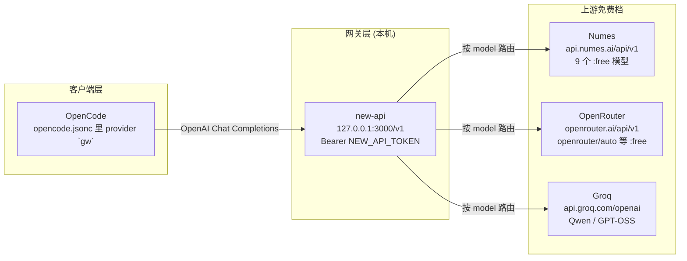
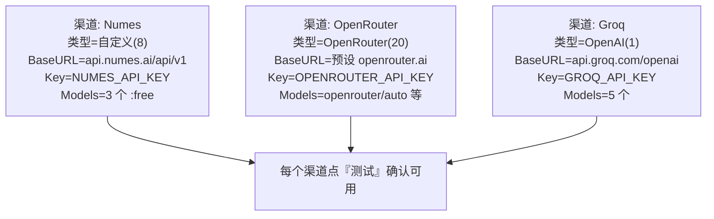
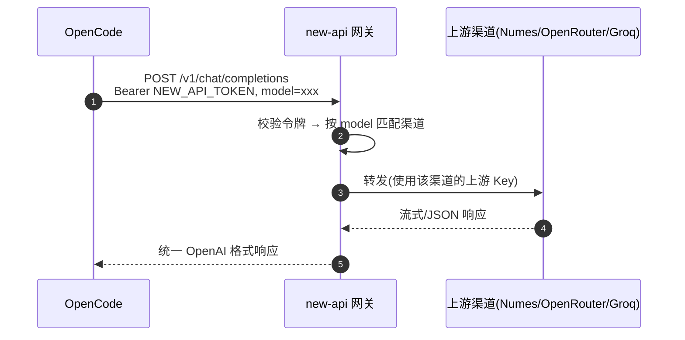
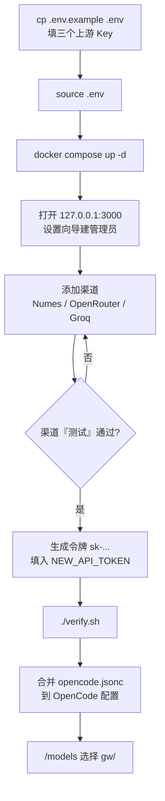

# Free API Gateway (new-api) —— 安装与使用手册

聚合 **Numes / OpenRouter / Groq** 三个第三方免费档，暴露统一 OpenAI 兼容端点给 OpenCode。
基于 [QuantumNous/new-api](https://github.com/QuantumNous/new-api)（AGPL-3.0）自托管。

---

## 1. 架构总览



> 要点：**客户端只用一把网关令牌**（`NEW_API_TOKEN`）访问 `127.0.0.1:3000/v1`；
> new-api 按请求里的 `model` 字段把流量路由到持有对应模型的那个渠道（上游 Key 只在网关内部使用）。

---

## 2. 前置条件

- 装好 **Docker**（或用 release 单二进制，见 §10）
- 已申请三个免费档 Key：

| 渠道 | 申请地址 | Key 前缀 | 备注 |
|---|---|---|---|
| Numes | https://numes.ai → API keys | `sk-numes-v1-` | 9 个免费模型 |
| OpenRouter | https://openrouter.ai/keys | `sk-or-v1-` | 100+ `:free` 模型 |
| Groq | https://console.groq.com/keys | `gsk_` | 高速免费推理 |

---

## 3. 配置环境变量

```bash
cd new-api-free-gateway
cp .env.example .env
# 编辑 .env，填入 NUMES_API_KEY / OPENROUTER_API_KEY / GROQ_API_KEY（NEW_API_TOKEN 先留空）
source .env
```

`.env` 已被 `.gitignore` 排除，**不会被提交**。仓库里只有 `.env.example` 占位符。

---

## 4. 启动网关

```bash
docker compose up -d
docker compose logs -f new-api   # 确认监听后 Ctrl+C
```

打开控制台 **http://127.0.0.1:3000** → 首次进入走**设置向导**创建管理员（默认组即可）。

> 默认仅绑定 `127.0.0.1`，局域网不可达；需要局域网访问再改 `docker-compose.yml` 的端口为 `0.0.0.0:3000:3000` 并自行加固（见 §9 安全）。

---


### 可选：Groq 提示词截断代理（控制 Groq 免费档 ITPM）

Groq 免费档输入 tokens/分钟仅 7000，OpenCode 的系统提示词约 7K tokens 会超限。
仓库提供 `groq-proxy.py`，在网关前加一层，仅对 Groq 模型截断 prompt：

```bash
# 启动代理（监听 3001，转发到 new-api 3000）
tmux new -d -s groq-proxy "cd /home/gw/project/new-api-free-gateway && python3 groq-proxy.py"
# OpenCode 的 baseURL 改为 http://127.0.0.1:3001/v1
```

> 代理只能缓解单次请求体积；Groq 免费档是滚动 60s 窗口，持续高频仍会 429。
> 建议 Groq 仅用于短对话/偶发查询，持续任务用 Numes/OpenRouter。

---

## 5. 添加三个渠道（控制台 →「渠道」→「添加渠道」）

渠道类型编号已按源码 `constant/channel.go` 核对：**Custom=8**、**OpenRouter=20**。

| 渠道 | 类型 | Base URL | Key | 模型（Models 字段，逗号分隔） |
|---|---|---|---|---|
| Numes | **自定义/Custom**（OpenAI 兼容） | `https://api.numes.ai/api/v1` | `NUMES_API_KEY` | `deepseek/deepseek-v4.1-flash:free, moonshotai/kimi-k3.1-pro:free, nvidia/nemotron-3-ultra-550b-a55b:free` |
| OpenRouter | **OpenRouter**（内置预设） | `https://openrouter.ai/api/v1`（预设自动） | `OPENROUTER_API_KEY` | `openrouter/auto, baidu/ernie-5.5-flash-preview:free, nvidia/nemotron-3.5-super-vl:free, nvidia/nemotron-3.5-lightning:free, nvidia/nemotron-3-ultra-550b-a55b:free, nvidia/nemotron-3-nano-omni-30b-a3b-reasoning:free, recursive/flint-v1.0:free` |
| Groq | **OpenAI**（内置类型，type=1） | `https://api.groq.com/openai` | `GROQ_API_KEY` | `qwen/qwen3.8-27b, openai/gpt-oss-120b, openai/gpt-oss-20b, allam-2-7b, openai/gpt-oss-safeguard-20b` |

添加规则：

- **分组（Group）**保持默认；务必勾选「启用」。
- **Models 字段填的是上游模型 ID**；OpenCode 侧调用用同一 ID，网关按 ID 路由到对应渠道。
- 想加更多模型：在渠道的 `Models` 里追加，同时在 `opencode.jsonc` 的 `models` 里加对应条目。

添加后逐个点击渠道「**测试**」按钮，确认返回成功。

### 渠道配置速查（各渠道要填的核心字段）



---

## 6. 创建网关令牌（供 OpenCode 用）

控制台 →「**令牌**」→ 添加令牌（默认分组），生成 **`sk-...`** 令牌。
把该令牌填回 `.env` 的 `NEW_API_TOKEN`，然后：

```bash
source .env
chmod +x verify.sh && ./verify.sh   # 列模型 + 抽查三条渠道各一个模型
```

---

## 7. 接入 OpenCode

把 [opencode.jsonc](./opencode.jsonc) 合并进你的 `~/.config/opencode/opencode.jsonc`（或项目级 `opencode.jsonc`），
确保 shell 里导出了 `NEW_API_TOKEN`：

```bash
export NEW_API_TOKEN=sk-xxxx   # 或写入 .env 并 source
opencode
```

在 `/models` 里选择 `gw/<model-id>`，例如：

- `gw/z-ai/glm-5.3-flash:free`（Numes）
- `gw/openrouter/auto`（OpenRouter）
- `gw/qwen/qwen3.8-27b`（Groq）

### 一次请求的完整链路



> **Numes 免费端点只支持 `reasoningEffort=high`**，`opencode.jsonc` 已为 Numes 模型统一设置；
> 若在 TUI 里选过 variant，按 `Ctrl+T` 选 `high`。

---

## 8. 设置流程全景



---

## 9. 常见问题与安全

### 排障表

| 现象 | 可能原因 | 处理 |
|---|---|---|
| `/v1/models` 401 | 令牌未填/无效 | 重新在「令牌」页生成，确认 `NEW_API_TOKEN` 已导出 |
| 某模型不可达 | 该渠道未启用 / Key 无效 | 渠道「测试」；检查 Key 与 Base URL |
| 429 / 超时 | 免费档限流或排队 | 稍后再试；或改用 Groq（更稳更快） |
| 首 token >30s | 免费档冷启动 | 属正常；耐心等待 |
| `reasoning.effort not supported` | Numes 模型默认 effort 不被支持 | 确认模型 `settings.reasoningEffort="high"` |
| 上游 5xx | 上游临时故障 | 用 `verify.sh --watch` 类轮询确认恢复 |

### 安全与合规

- **Key 不出本机**：上游 Key 只写进网关内部（数据库），客户端只用网关令牌。
- **勿发敏感内容**：部分免费档会用数据改进服务或留存 30 天（Numes/OpenRouter/Groq 按各自条款）。
- **端口**：默认只绑 `127.0.0.1`；开放局域网前务必确认信任边界，必要时用防火墙限制来源网段。
- **License**：new-api 为 **AGPL-3.0**；个人自托管无碍，对外分发/提供服务注意 copyleft 义务。
- **上游条款**：免费额度随时可能变更/下线，由使用者自行遵守上游政策。

---

## 10. 备选：单二进制运行（不用 Docker）

```bash
# 从 https://github.com/QuantumNous/new-api/releases 下载对应平台二进制
./new-api --port 3000
# 可选：启动 Groq 提示词截断代理（监听 3001）
python3 groq-proxy.py
# 同样访问 http://127.0.0.1:3000，数据默认在 ./data
```

---

## 附录：仓库文件清单

| 文件 | 作用 |
|---|---|
| `docker-compose.yml` | new-api 单实例（SQLite，仅 `127.0.0.1:3000`） |
| `.env.example` | 上游 Key 模板（真实值放 gitignored `.env`） |
| `opencode.jsonc` | OpenCode 对接配置（V2，17 个模型） |
| `verify.sh` | 网关/渠道连通性验证 |
| `README.md` | 仓库首页 |
| `SETUP.md` | 本文档 |
