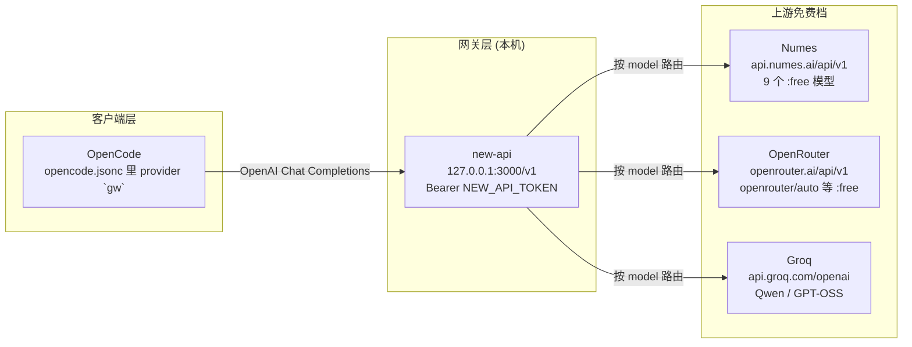
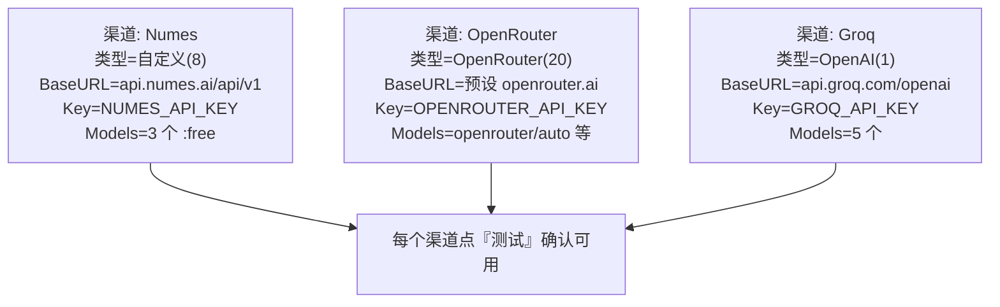
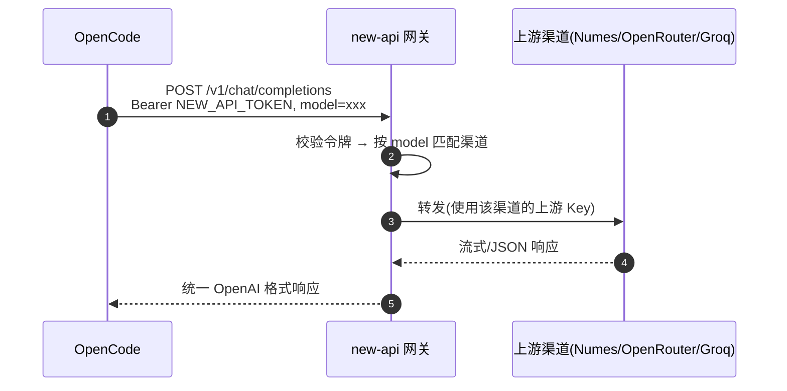
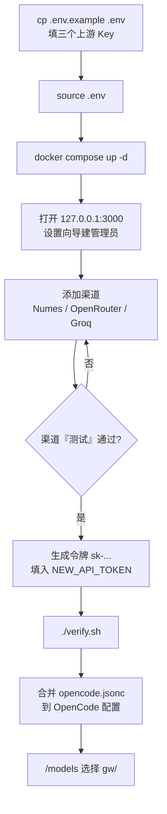

# Free API Gateway (new-api) —— 安装与使用手册

聚合 **Numes / OpenRouter / Groq** 三个第三方免费档，暴露统一 OpenAI 兼容端点给 OpenCode。
基于 [QuantumNous/new-api](https://github.com/QuantumNous/new-api)（AGPL-3.0）自托管。

---

## 1. 架构总览



> 要点：**客户端只用一把网关令牌**（`NEW_API_TOKEN`）访问 `127.0.0.1:3000/v1`；
> new-api 按请求里的 `model` 字段把流量路由到持有对应模型的那个渠道（上游 Key 只在网关内部使用）。

---

## 2. 前置条件

- 装好 **Docker**（或用 release 单二进制，见 §10）
- 已申请三个免费档 Key：

| 渠道 | 申请地址 | Key 前缀 | 备注 |
|---|---|---|---|
| Numes | https://numes.ai → API keys | `sk-numes-v1-` | 9 个免费模型 |
| OpenRouter | https://openrouter.ai/keys | `sk-or-v1-` | 100+ `:free` 模型；充值后可用付费模型（400+，如 `qwen/qwen3.8-max-0902`）；页面已中文化，支持支付宝/微信充值 |
| Groq | https://console.groq.com/keys | `gsk_` | 高速免费推理 |

---

## 3. 配置环境变量

```bash
cd new-api-free-gateway
cp .env.example .env
# 编辑 .env，填入 NUMES_API_KEY / OPENROUTER_API_KEY / GROQ_API_KEY（NEW_API_TOKEN 先留空）
source .env
```

`.env` 已被 `.gitignore` 排除，**不会被提交**。仓库里只有 `.env.example` 占位符。

---

## 4. 启动网关

```bash
docker compose up -d
docker compose logs -f new-api   # 确认监听后 Ctrl+C
```

打开控制台 **http://127.0.0.1:3000** → 首次进入走**设置向导**创建管理员（默认组即可）。

> 默认仅绑定 `127.0.0.1`，局域网不可达；需要局域网访问再改 `docker-compose.yml` 的端口为 `0.0.0.0:3000:3000` 并自行加固（见 §9 安全）。

---


### 可选：Groq 提示词截断代理（控制 Groq 免费档 ITPM）

Groq 免费档输入 tokens/分钟仅 7000，OpenCode 的系统提示词约 7K tokens 会超限。
仓库提供 `groq-proxy.py`，在网关前加一层，仅对 Groq 模型截断 prompt：

```bash
# 启动代理（监听 3001，转发到 new-api 3000）
tmux new -d -s groq-proxy "cd /home/gw/project/new-api-free-gateway && python3 groq-proxy.py"
# OpenCode 的 baseURL 改为 http://127.0.0.1:3001/v1
```

> 代理只能缓解单次请求体积；Groq 免费档是滚动 60s 窗口，持续高频仍会 429。
> 建议 Groq 仅用于短对话/偶发查询，持续任务用 Numes/OpenRouter。

---

## 5. 添加三个渠道（控制台 →「渠道」→「添加渠道」）

渠道类型编号已按源码 `constant/channel.go` 核对：**Custom=8**、**OpenRouter=20**。

| 渠道 | 类型 | Base URL | Key | 模型（Models 字段，逗号分隔） |
|---|---|---|---|---|
| Numes | **自定义/Custom**（OpenAI 兼容） | `https://api.numes.ai/api/v1` | `NUMES_API_KEY` | `deepseek/deepseek-v4.1-flash:free, moonshotai/kimi-k3.1-pro:free, nvidia/nemotron-3-ultra-550b-a55b:free` |
| OpenRouter | **OpenRouter**（内置预设） | `https://openrouter.ai/api/v1`（预设自动） | `OPENROUTER_API_KEY` | `openrouter/auto, baidu/ernie-5.5-flash-preview:free, nvidia/nemotron-3.5-super-vl:free, nvidia/nemotron-3.5-lightning:free, nvidia/nemotron-3-ultra-550b-a55b:free, nvidia/nemotron-3-nano-omni-30b-a3b-reasoning:free, recursive/flint-v1.0:free` |
| Groq | **OpenAI**（内置类型，type=1） | `https://api.groq.com/openai` | `GROQ_API_KEY` | `qwen/qwen3.8-27b, openai/gpt-oss-120b, openai/gpt-oss-20b, allam-2-7b, openai/gpt-oss-safeguard-20b` |

添加规则：

- **分组（Group）**保持默认；务必勾选「启用」。
- **Models 字段填的是上游模型 ID**；OpenCode 侧调用用同一 ID，网关按 ID 路由到对应渠道。
- 想加更多模型：在渠道的 `Models` 里追加，同时在 `opencode.jsonc` 的 `models` 里加对应条目。

添加后逐个点击渠道「**测试**」按钮，确认返回成功。

### 渠道配置速查（各渠道要填的核心字段）



---

## 6. 创建网关令牌（供 OpenCode 用）

控制台 →「**令牌**」→ 添加令牌（默认分组），生成 **`sk-...`** 令牌。
把该令牌填回 `.env` 的 `NEW_API_TOKEN`，然后：

```bash
source .env
chmod +x verify.sh && ./verify.sh   # 列模型 + 抽查三条渠道各一个模型
```

---

## 7. 接入 OpenCode

把 [opencode.jsonc](./opencode.jsonc) 合并进你的 `~/.config/opencode/opencode.jsonc`（或项目级 `opencode.jsonc`），
确保 shell 里导出了 `NEW_API_TOKEN`：

```bash
export NEW_API_TOKEN=sk-xxxx   # 或写入 .env 并 source
opencode
```

在 `/models` 里选择 `gw/<model-id>`，例如：

- `gw/z-ai/glm-5.3-flash:free`（Numes）
- `gw/openrouter/auto`（OpenRouter）
- `gw/qwen/qwen3.8-27b`（Groq）

### 一次请求的完整链路



> **Numes 免费端点只支持 `reasoningEffort=high`**，`opencode.jsonc` 已为 Numes 模型统一设置；
> 若在 TUI 里选过 variant，按 `Ctrl+T` 选 `high`。

---

## 8. 设置流程全景



---

## 9. 常见问题与安全

### 排障表

| 现象 | 可能原因 | 处理 |
|---|---|---|
| `/v1/models` 401 | 令牌未填/无效 | 重新在「令牌」页生成，确认 `NEW_API_TOKEN` 已导出 |
| 某模型不可达 | 该渠道未启用 / Key 无效 | 渠道「测试」；检查 Key 与 Base URL |
| 429 / 超时 | 免费档限流或排队 | 稍后再试；或改用 Groq（更稳更快） |
| 首 token >30s | 免费档冷启动 | 属正常；耐心等待 |
| `reasoning.effort not supported` | Numes 模型默认 effort 不被支持 | 确认模型 `settings.reasoningEffort="high"` |
| 上游 5xx | 上游临时故障 | 用 `verify.sh --watch` 类轮询确认恢复 |
| `` `tool calling` is not supported with this model `` | 模型（如 Groq `allam-2-7b`）不支持工具调用，但 OpenCode 仍带 `tools` | 见下方「无工具模型」说明 |
| `'messages.N' ... property 'reasoning_content' is unsupported` | 历史里的 `reasoning_content` 被回传给不认该字段的模型 | 见下方「无工具模型」说明 |
| `provider_overloaded`（503，Groq） | Groq 上游容量瞬时耗尽（大上下文/高峰） | 网关已开自动重试缓解；仍偶发属正常，稍后重试即可 |

### 无工具 / 非推理模型（如 Groq `allam-2-7b`）

OpenCode 的 `capabilities.tools` / `capabilities.reasoning` 只影响选择器与界面，**不会裁剪实际请求体**；
因此对上游拒绝 `tools` 或 `reasoning_content` 的模型，需在 `groq-proxy.py` 的 `NO_TOOLS` 集合中登记：

```python
NO_TOOLS = {"allam-2-7b"}  # 请求体剥离 tools/tool_choice 与 assistant 历史里的 reasoning_content
```

同时在 `opencode.jsonc` 里把该模型 `capabilities.tools` 置 `false`（并 `reasoning.supported: false`），
在 `sync-models.py` 的 `CAPABILITY_OVERRIDES` 里登记，避免 `sync-models` 把它改回 `true`。
改动后 `systemctl --user restart groq-proxy.service`。

### 网关自动重试（缓解上游瞬时 503）

new-api 支持对可重试状态码自动重试，适合 Groq 偶发 `provider_overloaded`。
在数据库 `options` 表（或用「系统设置」对应项）写入，改完重启容器：

```sql
INSERT INTO options(`key`,`value`) VALUES
 ('RetryTimes','2'),
 ('AutomaticRetryStatusCodes','429,500,502,503,504'),
 ('AutomaticDisableChannelEnabled','false'),
 ('MinRetryBackoff','1'),
 ('MaxRetryBackoff','8')
ON CONFLICT(`key`) DO UPDATE SET `value`=excluded.`value`;
```

- `RetryTimes`：单请求最大重试次数（`2`）。
- `AutomaticRetryStatusCodes`：哪些状态码触发重试。
- `AutomaticDisableChannelEnabled=false`：瞬时故障**不**自动禁用渠道，避免误伤。
- `Min/MaxRetryBackoff`：退避秒数。

> 重试只缓解瞬时抖动；若 Groq 长期 503，仍是上游容量问题，稍后再试或临时切换其他渠道。

### 安全与合规

- **Key 不出本机**：上游 Key 只写进网关内部（数据库），客户端只用网关令牌。
- **勿发敏感内容**：部分免费档会用数据改进服务或留存 30 天（Numes/OpenRouter/Groq 按各自条款）。
- **端口**：默认只绑 `127.0.0.1`；开放局域网前务必确认信任边界，必要时用防火墙限制来源网段。
- **License**：new-api 为 **AGPL-3.0**；个人自托管无碍，对外分发/提供服务注意 copyleft 义务。
- **上游条款**：免费额度随时可能变更/下线，由使用者自行遵守上游政策。
- **OpenRouter 充值**：充值后 `is_free_tier=false`，可访问付费模型（400+）。本项目仍控制在免费模型；页面已中文化，支持支付宝/微信充值。

---

## 10. 备选：单二进制运行（不用 Docker）

```bash
# 从 https://github.com/QuantumNous/new-api/releases 下载对应平台二进制
./new-api --port 3000
# 可选：启动 Groq 提示词截断代理（监听 3001）
python3 groq-proxy.py
# 同样访问 http://127.0.0.1:3000，数据默认在 ./data
```

---

## 11. 开机自启（systemd 用户服务）

仓库提供 `systemd/new-api.service` 与 `systemd/groq-proxy.service` 示例：

```bash
mkdir -p ~/.config/systemd/user
cp systemd/new-api.service systemd/groq-proxy.service ~/.config/systemd/user/
systemctl --user daemon-reload
systemctl --user enable --now new-api.service groq-proxy.service
# 验证
systemctl --user status new-api.service groq-proxy.service
```

> 已启用 `loginctl enable-linger`（用户未登录也运行）；如未启用：`sudo loginctl enable-linger $USER`。

---

## 12. 定期同步上游免费模型

`sync-models.py` 会每 6 小时自动执行：

1. 拉取 Numes / OpenRouter / Groq 的 `/v1/models`
2. 筛出免费（`:free`）与可聊天模型
3. 对尚未接入 OpenCode 的模型直接打一次最小请求做连通性测试
4. 写入 `channels.models`、重建 `abilities` 路由表、更新令牌 `model_limits`
5. 同步 `opencode.jsonc` 与 `~/.config/opencode/opencode.jsonc`
6. 重启 `new-api` / `groq-proxy`，并做一次端到端抽查

```bash
./sync-models.py --dry-run   # 只看计划，不改任何东西
./sync-models.py             # 手动执行一次
```

定时器（已包含在仓库 `systemd/`）：

```bash
cp systemd/sync-models.service systemd/sync-models.timer ~/.config/systemd/user/
systemctl --user daemon-reload
systemctl --user enable --now sync-models.timer
systemctl --user list-timers sync-models.timer
```

> 每次运行结果写入 `logs/sync-<时间>.log`，最新一份为 `logs/sync-latest.log`（日志已 gitignore）。
> 修改数据库前会自动备份为 `one-api.db.sync-bak`。

**两套场景（充值前/后）由 `.env` 两个变量切换，互不牺牲：**

| 变量 | 充值前（免费额度紧张） | 充值后（无限流） | 说明 |
|---|---|---|---|
| `SYNC_MAX_TEST` | `12` | 留空 | 每次最多测试的新模型数；留空=不限制 |
| `SYNC_TEST_SLEEP` | `1` | `0` | 每个测试之间的等待秒数；默认 1 |

```bash
# 充值前：保守，避免打爆每日 50 次免费额度
SYNC_MAX_TEST=12 SYNC_TEST_SLEEP=1 ./sync-models.py

# 充值后：一次全测、不加等待
SYNC_MAX_TEST= SYNC_TEST_SLEEP=0 ./sync-models.py
```

> 注意：即使充值后完全放开，上游偶发 429 时脚本仍按 `rate` 状态保留模型，不会误删。

---

## 附录：仓库文件清单

| 文件 | 作用 |
|---|---|
| `docker-compose.yml` | new-api 单实例（SQLite，仅 `127.0.0.1:3000`） |
| `.env.example` | 上游 Key 模板（真实值放 gitignored `.env`） |
| `opencode.jsonc` | OpenCode 对接配置（V2，随同步自动增删） |
| `groq-proxy.py` | Groq 提示词截断代理（控制 ITPM） |
| `verify.sh` | 网关/渠道连通性验证 |
| `sync-models.py` | 定期拉取免费模型、测连通、写回配置 |
| `systemd/*.service` | 开机自启与定时同步 unit 文件 |
| `systemd/*.timer` | 定期同步定时器（6 小时） |
| `README.md` | 仓库首页 |
| `SETUP.md` | 本文档 |
